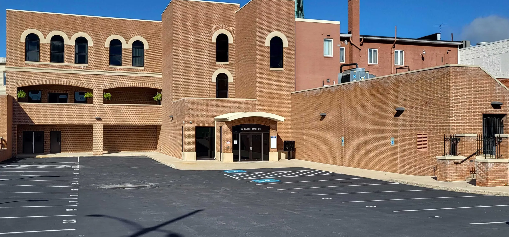

Our main workspace is in downtown Chambersburg at 20 South Main Street.

1. Park off South Central Avenue, behind the main Chambersburg square. Google Maps takes you to the right spot with this address: [20 S Main St, Chambersburg, PA 17201](https://maps.app.goo.gl/HEVNznVzjixQSrL26).
   - The lot is shared with other tenants. Please park only in spots 1–12, 18–24, or 29–42.
2. After parking, enter through the doors pictured below.

   

3. Our space is on the building's lower level, reached by an elevator or a stairwell. Both need a keycard.
   - Coordinate with a team mentor or volunteer so someone can unlock the doors for you when you visit.
