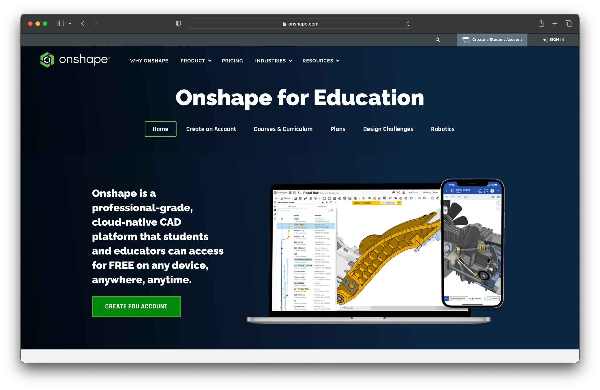
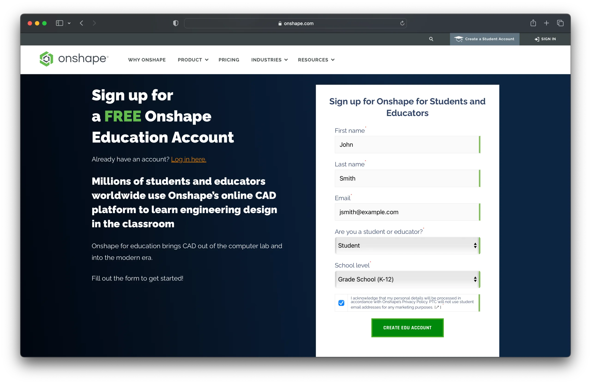
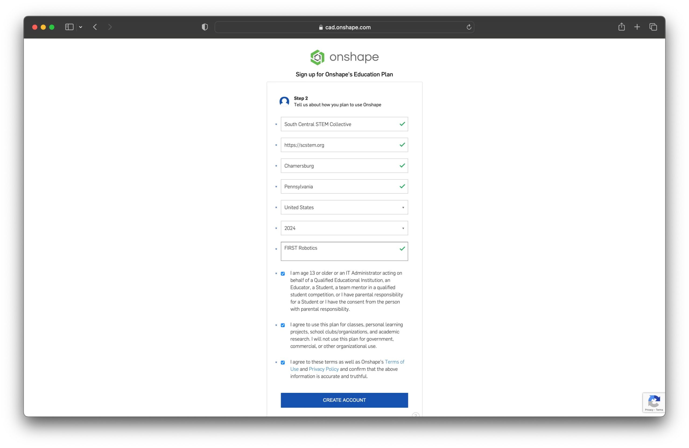

[Onshape](https://www.onshape.com/) is computer-aided design (CAD) software that runs entirely in your web browser, so it works well if you have limited access to a computer or your computer is not very powerful. Several students and mentors can work on the same project at the same time. Onshape has a [blog post](https://www.onshape.com/en/blog/how-to-onboard-your-first-robotics-team) on how _FIRST_ robotics teams use it.

Beyond Onshape's own parts, these libraries hold the components _FIRST_ robotics teams use most:

- [_FIRST_ Tech Challenge](https://cad.onshape.com/documents/48f46b1b8cf1df6fc775962e/w/1f405d5721c52faf30bdedca/e/32cd80978653af997ac758d6?renderType=V3_UI), with a [video tutorial](https://www.youtube.com/watch?v=KP3pT9OsiW8&list=PLOPIJtr7Kd_4fWM4k3pIYLE6qnFJXDeSE&t=380s).
- [_FIRST_ Robotics Competition](https://www.chiefdelphi.com/t/pic-introducing-mkcad-the-onshape-frc-parts-library/161295) (MKCad).

## Create an account

A free education account takes a few minutes to set up.

1. Go to [onshape.com/en/education](https://www.onshape.com/en/education/) and choose "Create EDU Account".

   

2. Fill in the form with your contact information and click "Create EDU Account".

   

3. The next page asks about your education. Complete the form and choose "Create Account".

   

4. Onshape emails you to finish creating your account: you set a password and get access to the software.

## Join our team

If you are on Biohazard, our FRC team, ask a mentor on Slack for an invitation to our Onshape team. A team lets members work on the same parts and projects at the same time.
